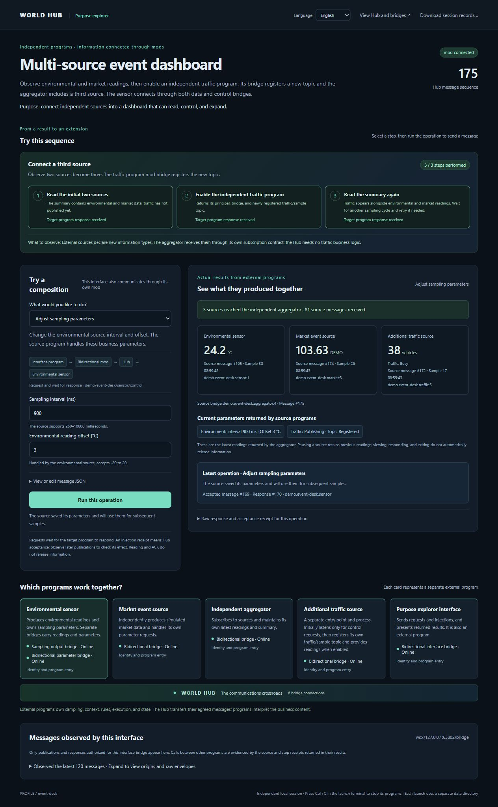
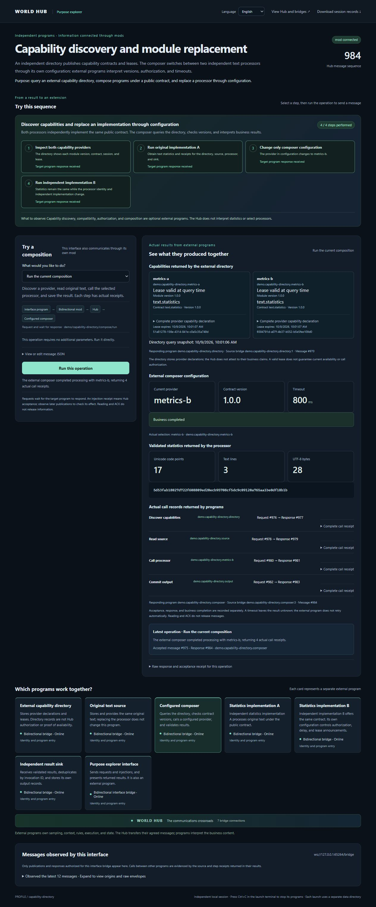

# World Hub · 世界枢纽

[简体中文](README.md) | **English**

**Connect everything. Compose freely. Decouple systems. Make hardcoded connections adaptable. Plug and unplug everything. Route information freely. Extend with open-ended modules.**

Keep editors, conversations, knowledge sources, model executors, tools and interfaces in independent programs. Let their bidirectional hub bridges exchange information. Programs can be replaced while their peers follow shared communication and application contracts.

```text
Program A    ↔ hub bridge ─┐                  ┌─ hub bridge ↔ Program B
Program C    ↔ hub bridge ─┼─ one Global Hub ─┼─ hub bridge ↔ Program D
External app ↔ hub bridge ─┘                  └─ hub bridge ↔ other programs
```

The Hub accepts, addresses, retains and forwards information. Programs own business rules, information types, context, workflows and results. Bridges register channels; the Hub does not enumerate application categories.

A **module** combines a program and its **hub bridge** in an independently installable artifact. A hub bridge is the bidirectional communication adapter that connects the program to the Hub. A program may use several hub bridges, embedded or separate. It does not have to become a Hub Core plugin.

## Start with modules

```powershell
npm install -g world-hub
world-hub --open
```

Startup opens the **communication management interface**. Import modules, manage groups, edit wiring and startup plans, and observe programs, bridges and information flows in one interface. All local instances use **the same Hub**. A separate Launcher, packs and templates are no longer part of this flow.

1. Import an author's module directory, ZIP or community `artifact.json`, or download an individual module or group through Workshop.
2. Check the version, instance name, public settings, topics and bridge permissions before confirming import. A module may have several independent instances.
3. Configure wiring, capability bindings and startup plans through the wiring and orchestration modes.
4. Check current source, interpreters and permissions before starting. Observe processes, logs, actual bridge connections and information flow.
5. Create groups referencing existing instances, or import an author's published group. Members outside the startup plan can still be started individually later.

An instance can belong to several groups, sharing its configuration, state and process. Membership does not copy modules, grant permissions or create another Hub. Operating on a shared member affects other groups referencing it. Create another instance for separate parameters or data.

Import and authoring tools support local path selection; environment detection helps choose an interpreter. See [module declarations](docs/ecosystem/modules.md) for module and shareable group formats, and [Workshop](docs/ecosystem/workshop.md) for community downloads and publishing.

Choose published versions for modules and groups, upgrade or downgrade installed instances, and review rollback changes. Wiring mode can restore an author's default connections. Modules support resident and on-demand execution: authors can recommend a mode and idle timeout; users override them locally and select callers allowed to wake the module. Authorized managed calls can wake an on-demand module and stop it after completed work becomes idle. The interface supports Simplified Chinese and English. See [module management](docs/ecosystem/modules.md) for version, data and lifecycle boundaries.

The communication management interface manages processes it starts. Existing applications, Electron hosts and self-managed services can [connect directly](docs/ecosystem/external-programs.en.md) to the same Hub while retaining their own installation and lifecycle.

## What can you compose?

| System | Independent programs | Collaboration |
| --- | --- | --- |
| Multi-source dashboard | Sensors, application events, aggregation, interface | Sources feed one panel; the interface returns control information |
| Modular AI workspace | System prompts, conversations, knowledge, context assembly, model/harness, tools, interface | Assemble distributed context, invoke an executor and return results; replace sources and executors independently |
| Dynamic digital world | State, rules, NPCs, director, display | A director requests programs each round; rules update state for the next round |
| Multi-round workflow | Acquisition, analysis, validation, output, controller | An external controller schedules rounds involving several programs |
| Replaceable capabilities | Directory, assembler, independently authored providers | Choose providers by public contracts and verify identities and results |

Controllers remain outside the Hub. It does not interpret prompts, run world rules, select models or schedule application workflows. Delivery and ACK do not prove business success. Providers choose retention and release policies.

## Develop and connect independently

Install the official **World Hub Skill** for agent guidance, or use **World Hub MCP** to publish, pull, call and inject information through the agent's own hub bridge:

```sh
world-hub-skill --install ./my-agent/.agents/skills/world-hub
world-hub-mcp --prepare
world-hub-mcp --config /absolute/private/world-hub-mcp.json
```

MCP uses separately locked optional dependencies and stdio protocol 2026-07-28. Configure the client's command and private bridge credentials. Installing the Skill starts no programs; MCP preserves Hub permissions. See [Skill and MCP integration](docs/ecosystem/agents.en.md).

Use the [JavaScript](sdk/javascript/README.md), [Python](sdk/python/README.md) or [PowerShell](sdk/powershell/README.md) SDK, or implement a bridge using the [wire protocol](docs/specs/protocol.md).

```javascript
import { Bridge } from 'world-hub/bridge';
```

The deployer supplies the endpoint, independent credentials and topic permissions. A module importable through the communication management interface supplies `module.json`; optional `deployment.json` describes recommended public settings and wiring. Authors choose layout, behavior and interface. See the [author guide](docs/ecosystem/developer.en.md), [module declarations](docs/ecosystem/modules.md) and [independent-program guide](docs/ecosystem/external-programs.en.md).

Matching names do not establish replaceability. Check identities, exact contract versions, semantics and consumer behavior. The [provider contract](docs/modules/provider-contract.md), [machine contract](docs/modules/text-statistics.contract.json) and [interoperability benchmark](docs/ecosystem/interop.md) offer an independently implementable text-statistics example.

## Sources and community

[World Hub Workshop](https://peros.cn/workshop/) is an optional independent distribution service for **individual modules and module groups**. The local communication management interface verifies index and artifact digests before acquiring content. Groups share member sources, public configuration, wiring and a startup plan; imported members remain independent instances on the same Hub and can be managed individually. Downloads and imports do not start programs. Local modules and the Hub do not require the community service to stay online.

Downloads, signature verification and community login do not grant local execution permission. Current code, interpreters and permissions still require review. Declared permissions are not an operating-system sandbox. Source addresses and trust policies are explicit user choices. See [sources](docs/ecosystem/sources.md) and [Workshop](docs/ecosystem/workshop.md).

## Explore real information flows

The source repository retains an event desk, distributed-context assistant, digital world and capability directory. Ordinary external programs communicate through real bridges.

```powershell
git clone https://github.com/oooBCKooo/world-hub.git
cd world-hub
npm run demo:events-explorer
# Or demo:assistant-explorer, demo:world-explorer, demo:capabilities-explorer
```

Run one at a time. They use private temporary data and a demonstration Hub, rather than community module or group import artifacts. The assistant uses a deterministic executor and needs no model account. Passing a reference demonstration does not establish arbitrary third-party compatibility.





## Principles

**Connection. Freedom. Decoupling. Adaptability. Pluggability. Flexible flows. Open-ended extension.**

Connect programs through common contracts. Keep their implementation and state independent. Make wiring configurable. Let programs and bridges connect, disconnect and be replaced. Support bidirectional, many-to-many and multi-round flows without enumerating future applications.

Machine capacity, access rules, protocol limits and actual program capabilities still apply. Open-ended composition does not provide unlimited resources or automatic compatibility.

## Deployment and development

- [Documentation](docs/README.md): communication management, direct connections, SDKs and specifications.
- [npm usage](docs/npm.md): CLI, SDK exports and private data locations.
- [Deployment](docs/deployment.md): configuration, storage and capacity; `world-hub --open` starts the communication service directly.
- [Development](docs/development.md) and [verification scope](docs/verification.md): assess support from actual evidence.
- [Builds](docs/releases.md) and [repository structure](docs/repository.md): explicit file lists exclude user data.

The wire remains `wire: "0.1"`; features are negotiated through `welcome.features`. The separate Launcher, packs and templates have left the current product path. Historical materials are not current usage instructions.

Source and documentation use the [MIT license](LICENSE). Bundled Node runtimes and third-party programs retain their own licenses.
