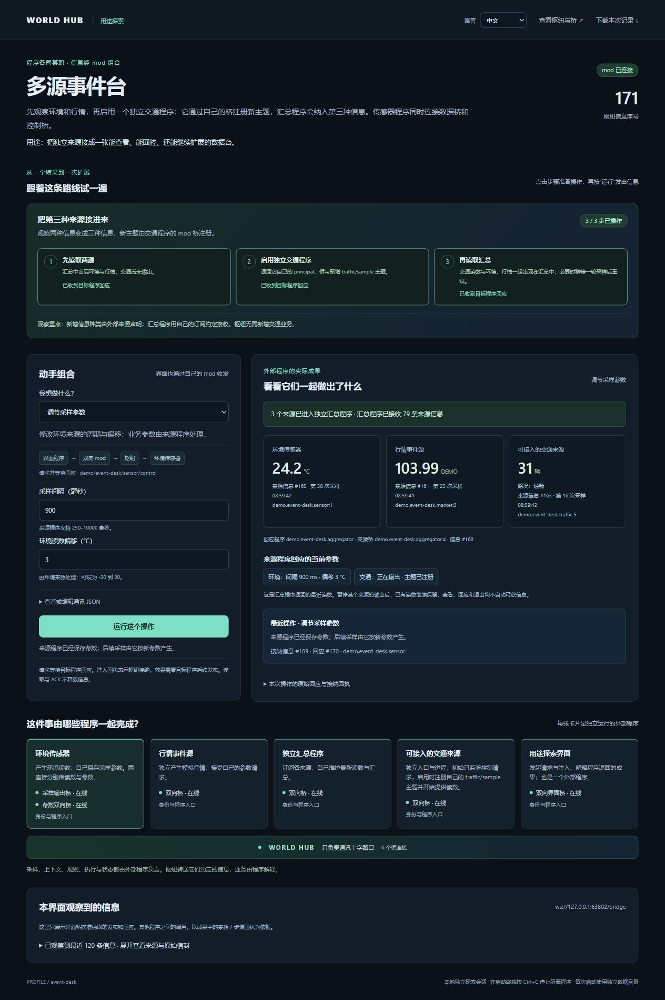
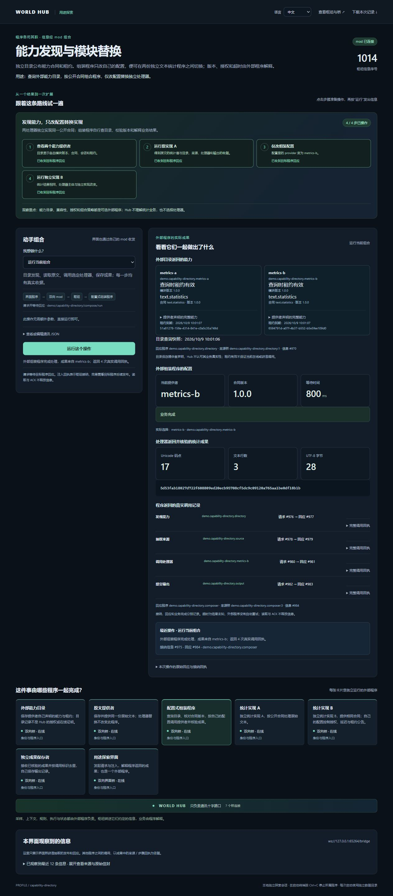

# 世界枢纽 · World Hub

[中文](README.md) | [English](README.en.md)

**互联万物，自由组合，解耦整体，软化硬码，拔插一切，任意流线，无限模块。**

把编辑器、对话、资料、模型执行器、工具和界面拆成独立程序，让它们通过各自的双向模块桥交换信息。替换一个程序时，其他程序继续遵守共同的通信与业务契约。

```text
程序 A ↔ 模块桥 ─┐                ┌─ 模块桥 ↔ 程序 B
程序 C ↔ 模块桥 ─┼─ 一个全局 Hub ─┼─ 模块桥 ↔ 程序 D
外部程序 ↔ 模块桥┘                └─ 模块桥 ↔ 其他程序
```

Hub 是通信十字路口，负责接纳、寻址、留存和转交信息。业务规则、信息种类、上下文、工作流与成果由程序自己决定。通道由模块桥登记，Hub 不内置穷举业务类型。

**模块**是可独立安装的程序制品；**模块桥（module bridge）**是程序与 Hub 之间的双向通信适配层。一个程序可以使用多个模块桥，桥可以嵌入程序或独立运行；程序无需成为 Hub 内核插件。

## 从模块开始

```powershell
npm install -g world-hub
world-hub --open
```

启动后直接打开**通信管理界面**，在同一个界面导入模块、管理模块组、编辑接线和启动计划，并观察程序、模块桥与信息流。所有本机实例使用**同一个 Hub**。无需独立 Launcher、整合包或模板。

1. 导入作者提供的模块目录、ZIP 或社区 `artifact.json`，也可在工坊下载单模块或模块组。
2. 核对所选版本、实例名称、公开参数、通道与桥权限，再确认导入。同一模块可建立多个独立实例。
3. 在接线与编排模式配置实例接线、能力绑定和启动计划。
4. 核对当前源码、解释器和权限后启动，观察进程、日志、真实模块桥连接与信息流。
5. 创建模块组引用已有实例，或导入作者发布的模块组。未列入启动计划的成员仍可随后单独启动。

一个实例可被多个组引用，共享同一份配置、状态和进程；分组不会复制模块、增加权限或创建另一个 Hub。操作共享成员会影响引用它的其他组。需要独立参数或数据时，新建实例。

导入和创作入口支持本机路径选择；环境探测帮助选择解释器。单模块与可分享的模块组格式见[模块声明](docs/ecosystem/modules.md)，社区下载与发布见[Workshop](docs/ecosystem/workshop.md)。

模块与模块组可选择发行版本、原位升级、降级和审阅回退；接线模式可恢复作者默认接线。模块可设为常驻或按需运行，作者可提供默认模式和空闲时间，用户在本机覆盖并选择允许唤醒的调用者。已授权的受管调用可先唤醒按需模块，完成后按空闲策略停止。界面支持简体中文与英文切换。版本、数据与自动启停边界见[模块管理说明](docs/ecosystem/modules.md)。

通信管理界面管理它启动的进程。已有程序、Electron 桌面宿主或自行管理的服务也可以按[独立程序接入指南](docs/ecosystem/external-programs.md)直接连接同一个 Hub，自行负责安装和运行。

## 可以组合出什么

| 系统 | 独立程序 | 如何协作 |
| --- | --- | --- |
| 多来源数据面板 | 传感器、应用事件、汇总、界面 | 多个来源进入同一面板，界面向来源返回控制信息 |
| 模块化智能工作台 | 系统提示、对话、知识库、上下文组装、模型／harness、工具、界面 | 从多个程序抽取上下文，交给执行器，再把成果交给界面；来源与执行器分别替换 |
| 动态数字世界 | 世界状态、规则、NPC、导演、显示 | 导演每轮请求多个程序，规则计算结果写回状态，再进入下一轮 |
| 多轮工作流 | 获取、分析、校验、产出、流程控制 | 外部工作流程序安排多轮、每轮多个程序的调用与合并 |
| 可替换能力 | 能力目录、组装器、不同作者的处理器 | 按公开业务契约选择提供者，保留精确身份和结果验证 |

这些控制程序也在 Hub 外部。Hub 不解释系统提示词，不运行世界规则，不选择模型，也不调度业务工作流。抽取或 ACK 不代表业务成功；释放和留存由提供者的策略决定。

## 独立开发与接入

可使用 [JavaScript](sdk/javascript/README.md)、[Python](sdk/python/README.md)、[PowerShell](sdk/powershell/README.md) SDK，也可按[线协议](docs/specs/protocol.md)自行实现模块桥。

```javascript
import { Bridge } from 'world-hub/bridge';
```

部署方提供 Hub 地址、独立身份凭据和主题权限。交付可由通信管理界面导入的模块时提供 `module.json`，可选 `deployment.json` 声明作者推荐的公开参数与接线。源码组织、业务和界面由作者选择。见[模块作者指南](docs/ecosystem/developer.md)、[模块声明](docs/ecosystem/modules.md)和[独立程序接入](docs/ecosystem/external-programs.md)。

相同名称不代表可替换：需核对通信身份、契约版本、输入输出语义和消费者行为。[提供者接入契约](docs/modules/provider-contract.md)、[机器契约](docs/modules/text-statistics.contract.json)与[互操作基准](docs/ecosystem/interop.md)提供一个可独立实现的文字统计示例。

## 软件来源与社区

[World Hub Workshop](https://peros.cn/workshop/) 是可选的独立分发服务。社区分发**单模块与模块组**，本机通信管理界面的工坊验证索引和内容摘要后取得制品。模块组分享成员源码、公开配置、接线与启动计划；导入后，成员作为独立实例连接同一个 Hub，仍可单独管理。下载或导入不会自动启动程序，本地模块和 Hub 不依赖社区在线。

下载、签名验证和社区登录不授予本机执行权限。启动前仍需审阅源码、解释器与权限。声明权限不是操作系统沙箱；源地址和可信范围由使用者明确配置。见[软件来源](docs/ecosystem/sources.md)和[Workshop](docs/ecosystem/workshop.md)。

## 探索真实信息流

仓库保留多源事件台、分布式上下文助手、数字世界和能力目录四个独立通信演示。普通外部程序通过真实模块桥交换信息。

```powershell
git clone https://github.com/oooBCKooo/world-hub.git
cd world-hub
npm run demo:events-explorer
# 或 demo:assistant-explorer、demo:world-explorer、demo:capabilities-explorer
```

每次选择一个演示。演示使用临时数据和独立演示 Hub，不是社区模块或模块组的导入制品。助手使用确定性执行器，无需模型账号。参考演示通过不代表任意第三方程序已经兼容。





## 设计理念

**互联，自由，解耦，软化，拔插，任意，无限。**

| 理念 | 含义 |
| --- | --- |
| 互联 | 程序通过双向模块桥交换信息与调用能力 |
| 自由 | 按共同契约选择模块和组合关系 |
| 解耦 | 程序独立管理业务、状态和实现 |
| 软化 | 把固定接线变成可配置的桥、通道与契约 |
| 拔插 | 按契约接入、断开与替换程序和桥 |
| 任意 | 支持双向、多对多和多轮信息流 |
| 无限 | 不预先穷举业务模块、信息种类与组合用途 |

扩展仍受机器容量、权限、协议限制和程序实际能力约束。开放的组合空间不等于无限资源或自动兼容。

## 部署与开发

- [文档入口](docs/README.md)：通信管理、直接接入、SDK 和通信规格。
- [npm 使用](docs/npm.md)：CLI、SDK 导出、自己的数据目录。
- [部署](docs/deployment.md)：配置、存储与容量；`world-hub --open` 可直接启动通信服务。
- [开发](docs/development.md)与[验证范围](docs/verification.md)：按测试实际证据判断支持范围。
- [构建与分发](docs/releases.md)、[仓库结构](docs/repository.md)：明确文件清单，不携带用户数据。

Hub 线协议保持 `wire: "0.1"`，附加能力通过 `welcome.features` 协商。独立 Launcher、整合包和模板已退出当前产品路径，旧资料不再作为当前使用指南。

源码与文档采用 [MIT](LICENSE) 许可。便携包携带的 Node 运行时与第三方程序保留各自许可。
